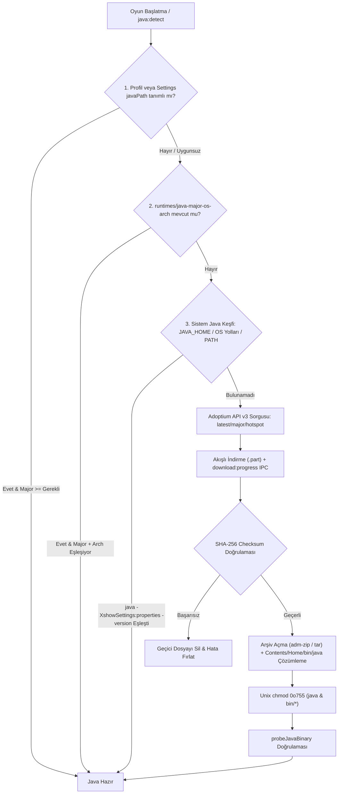

# Vortex Launcher — Mimari Tasarım Dokümanı (`LAUNCHER_ARCH.md`)

Bu doküman; **Windows**, **macOS** ve **Linux** işletim sistemleriyle tam uyumlu, **Electron + React + TypeScript + Tailwind CSS** teknoloji yığını üzerine kurgulanan **Vortex Launcher** projesinin sistem mimarisini tanımlar.

---

## 1. İşletim Sistemi Uyumluluğu ve Standart Dizin Çözümleme Mantığı

Launcher, tüm dosya yollarında platform bağımsızlığı sağlamak amacıyla yalnızca Node.js `path.join`, `path.resolve`, `path.delimiter` API'lerini, `os.homedir()` metodunu ve Electron'un `app.getPath('appData')` çağrısını kullanır. Kod tabanının hiçbir noktasında sabit (`\` veya `/`) yol ayırıcısı ya da (`;` veya `:`) classpath ayırıcısı kullanılmaz.

### 1.1. Platform Bazlı Kök Dizin Çözümlemesi (`PathManager`)

| İşletim Sistemi | `process.platform` | `app.getPath('appData')` Varsayılanı | Veri Kök Dizini (`getRootDir()`) | Ayar/Config Dizini (`getConfigDir()`) |
| :--- | :--- | :--- | :--- | :--- |
| **Windows** | `win32` | `%APPDATA%` (`C:\Users\<Kullanıcı>\AppData\Roaming`) | `%APPDATA%\VortexLauncher` | `%APPDATA%\VortexLauncher\config` |
| **macOS** | `darwin` | `~/Library/Application Support` | `~/Library/Application Support/VortexLauncher` | `~/Library/Application Support/VortexLauncher/config` |
| **Linux** | `linux` | `$XDG_CONFIG_HOME` veya `~/.config` | `$XDG_DATA_HOME/VortexLauncher` (`~/.local/share/VortexLauncher`) | `$XDG_CONFIG_HOME/VortexLauncher/config` (`~/.config/VortexLauncher/config`) |

#### Linux XDG Dizin Politikası
Linux'ta Electron'un `app.getPath('appData')` çağrısı XDG standardı gereği `$XDG_CONFIG_HOME` (`~/.config`) dizinini döndürür. Ancak gigabaytlarca yer kaplayabilen JAR dosyaları, asset nesneleri, modlu profil örnekleri ve Java çalışma zamanlarının `~/.config` içinde birikmemesi için `PathManager` sınıfı (`src/main/paths.ts`):
- **Yapılandırma dosyalarını** (`settings.json`, `profiles.json`, `accounts.json`) `app.getPath('appData')` / `$XDG_CONFIG_HOME` (`~/.config/VortexLauncher/config`) altında tutar.
- **Büyük oyun verilerini** (`runtimes/`, `versions/`, `libraries/`, `assets/`, `instances/`, `cache/`) `process.env.XDG_DATA_HOME` veya `~/.local/share/VortexLauncher` altında çözümler.

```ts
// src/main/paths.ts — Çapraz platform dizin çözümleme mantığı
const LAUNCHER_DIR_NAME = 'VortexLauncher';
const appDataDir = this.resolveAppDataDir(); // app.getPath('appData') + platform fallback
this.configRootDir = path.join(appDataDir, LAUNCHER_DIR_NAME);

if (process.platform === 'linux') {
  const xdgDataHome =
    process.env.XDG_DATA_HOME && process.env.XDG_DATA_HOME.trim().length > 0
      ? process.env.XDG_DATA_HOME
      : path.join(os.homedir(), '.local', 'share');
  this.rootDir = path.join(xdgDataHome, LAUNCHER_DIR_NAME);
} else {
  // Windows (%APPDATA%) ve macOS (~/Library/Application Support)
  this.rootDir = path.join(appDataDir, LAUNCHER_DIR_NAME);
}
```

### 1.2. Çözümlenen Veri ve Konfigürasyon Klasör Yapısı

```text
<LauncherRoot>/                         # Windows: %APPDATA%\VortexLauncher
│                                       # macOS:   ~/Library/Application Support/VortexLauncher
│                                       # Linux:   ~/.local/share/VortexLauncher
├── runtimes/                           # Otomatik indirilen Adoptium/Temurin JRE paketleri
│   └── java-<major>-<os>-<arch>/
├── versions/                           # Sürüm metadata (.json), client (.jar) ve native kütüphaneler
│   └── <versionId>/
│       ├── <versionId>.json
│       ├── <versionId>.jar
│       └── natives/                    # İşletim sistemine özgü .dll / .dylib / .so dosyaları
├── libraries/                          # Maven düzeninde Java kütüphaneleri (group/artifact/version/*.jar)
├── assets/                             # Mojang asset indeksleri ve içerik adresli objeler
│   ├── indexes/<assetIndex>.json
│   └── objects/<2-hex>/<sha1>
├── instances/                          # Profil bazlı izole oyun çalışma dizinleri (--gameDir)
│   └── <profileId>/
│       ├── mods/
│       ├── config/
│       ├── saves/
│       ├── resourcepacks/
│       └── logs/
└── cache/                              # Sürüm manifestleri ve geçici .part indirme dosyaları

<ConfigRoot>/                           # Windows/macOS: <LauncherRoot>/config
└── config/                             # Linux: ~/.config/VortexLauncher/config
    ├── settings.json                   # RAM, Java yolu, seçili sürüm/profil, tema ID ("patrick-jane")
    ├── profiles.json                   # Kurulum profilleri
    └── accounts.json                   # Çevrimdışı nickler ve safeStorage ile şifreli Microsoft tokenları
```

### 1.3. İşletim Sistemine Özgü Çalışma Zamanı Farkları

- **Classpath Ayırıcı (`path.delimiter`):** JVM `-cp` argümanı oluşturulurken Windows'ta `;`, macOS ve Linux'ta `:` kullanılır.
- **Native Kütüphane Çıkarımı (`extractNatives`):** Mojang sürüm manifestindeki `rules` ve `natives` kuralları `process.platform` değerine göre filtrelenir (`.dll` Windows, `.dylib` macOS, `.so` Linux); `META-INF/` hariç tutularak `versions/<versionId>/natives/` altına çıkarılır.
- **macOS LWJGL/GLFW Zorunluluğu:** `process.platform === 'darwin'` ortamında JVM argümanlarına otomatik olarak `-XstartOnFirstThread` eklenir; aksi halde GLFW/OpenGL pencere döngüsü macOS ana iş parçacığı (AppKit main thread) hatasıyla çöker.

---

## 2. Java Yönetimi (Adoptium / Temurin Otomatik Algılama ve İndirme Akışı)

Farklı Minecraft sürümleri farklı Java LTS sürümleri gerektirir. `JavaManager` (`src/main/java/JavaManager.ts`), hedef Minecraft sürümüne, işletim sistemine ve CPU mimarisine (`x64` veya `arm64` — Apple Silicon M1/M2/M3/M4 dahil) tam uyumlu JRE ortamını otomatik olarak algılar ya da Adoptium API v3 üzerinden indirip kurar.

### 2.1. Minecraft Sürümü → Java Major Sürüm Eşlemesi

| Minecraft Sürüm Aralığı | Gerekli Java Major | Eclipse Temurin Dağıtımı |
| :--- | :--- | :--- |
| `>= 1.20.5` (`1.20.5`, `1.20.6`, `1.21.x+` ve `24w14a+` snapshot'lar) | **Java 21** | Eclipse Temurin 21 LTS (JRE) |
| `1.17` – `1.20.4` (`21w`–`24w13a` snapshot'lar dahil) | **Java 17** | Eclipse Temurin 17 LTS (JRE) |
| `<= 1.16.5` (`1.8.9`, `1.12.2`, `1.16.5` vb.) | **Java 8** | Eclipse Temurin 8 LTS (JRE) |

### 2.2. İşletim Sistemi ve İşlemci Mimarisi Eşlemesi

| Node.js `process.platform` | Adoptium `os` Parametresi | Node.js `process.arch` | Adoptium `architecture` Parametresi | Arşiv Formatı |
| :--- | :--- | :--- | :--- | :--- |
| `win32` | `windows` | `x64` / `arm64` | `x64` / `aarch64` | `.zip` (`adm-zip`) |
| `darwin` | `mac` | `x64` / `arm64` (Apple Silicon) | `x64` / `aarch64` | `.tar.gz` (`tar`) |
| `linux` | `linux` | `x64` / `arm64` | `x64` / `aarch64` | `.tar.gz` (`tar`) |

### 2.3. 3 Aşamalı Algılama ve Otomatik İndirme Akışı



---

## 3. Çift Giriş Sistemi ve Ayar/Tema Kalıcılığı

### 3.1. Zorunlu Hesap Olmadan Çift Giriş Mimarisi (`src/main/auth/`)

- **Çevrimdışı / Hesapsız Mod (`OfflineAuthProvider.ts` — Varsayılan):** Kullanıcı herhangi bir hesap açmadan yalnızca kullanıcı adı girerek oyunu başlatabilir (`launchGame(profileId, { offlineUsername })` veya `loginOffline`). `OfflinePlayer:<username>` dizesinden standart **RFC 4122 UUID v3** (MD5) üretilir ve oyun `accessToken: "0"`, `user_type: "legacy"` parametreleriyle başlatılır.
- **İsteğe Bağlı Microsoft OAuth (`MicrosoftAuthProvider.ts`):** İsteyen kullanıcılar için ayrı bir modül olarak **Microsoft OAuth → Xbox Live → XSTS → Minecraft Services → Profile/Skin** zincirini çalıştırır; `AZURE_CLIENT_ID` tanımlandığında `authorization_code` ve `refresh_token` yenilemesini destekler, Xbox `XErr` hata kodlarını anlaşılır mesajlara çevirir.
- **Güvenli Çoklu Hesap Yöneticisi (`AuthManager.ts` + `TokenCrypto.ts`):** Birden fazla çevrimdışı nick ve/veya Microsoft hesabını `accounts.json` dosyasında atomik olarak saklar. Microsoft `accessToken` ve `refreshToken` değerleri disk üzerinde Electron `safeStorage` (Windows DPAPI, macOS Keychain, Linux Secret Service) ile şifrelenir (`enc:v1:...`); Renderer'a gönderilen durumlarda (`getAuthState()`) tokenlar maskelenir (`***`).

### 3.2. Ayar ve Tema Kalıcılığı (`SettingsManager.ts`)

`src/main/settings/SettingsManager.ts`, kullanıcı tercihlerini `settings.json` dosyasında atomik yazım (`.tmp` → `rename`) ile saklar:
- `memoryGB`: Sistem RAM'ine göre otomatik önerilen ve 0.5 GB adımlarla doğrulanan bellek tahsisi.
- `javaPath`: Global özel Java yürütülebilir dosya yolu.
- `activeProfileId`, `selectedVersion`, `selectedLoader`: Son seçili profil, sürüm ve mod yükleyici.
- `lastOfflineUsername`: Hesapsız hızlı başlatmada kullanılan son kullanıcı adı.
- `themeId`: Aktif tema kimliği (**varsayılan: `"patrick-jane"`**).
- `language`, `closeLauncherOnGameStart`, `showSnapshots`, `autoCheckUpdates`: Davranış ayarları.

---

## 4. Klasör Yapısı ve Güvenli IPC (`preload.ts`) Mimarisi

### 4.1. Kaynak Kod Klasör Ağacı

```text
MinecraftLauncher/
├── LAUNCHER_ARCH.md
├── package.json
├── electron-builder.yml
├── tsconfig.json                   # Renderer Process TypeScript yapılandırması
├── tsconfig.node.json              # Main & Preload Process TypeScript yapılandırması
├── vite.config.ts
├── tailwind.config.js
├── postcss.config.js
├── index.html
├── build/
│   └── entitlements.mac.plist      # macOS Hardened Runtime + JVM JIT izinleri
└── src/
    ├── shared/                     # Main, Preload ve Renderer ortak sözleşmeleri
    │   ├── ipcChannels.ts          # IPC kanal sabitleri (IPC_CHANNELS)
    │   └── types.ts                # Ayarlar, Profiller, Hesaplar, Sürümler, LauncherAPI tipleri
    ├── main/                       # Electron Main Process (Tam yetkili Node.js çekirdeği)
    │   ├── main.ts                 # Yaşam döngüsü, BrowserWindow güvenlik ayarları, bootstrap
    │   ├── paths.ts                # Cross-platform PathManager (VortexLauncher)
    │   ├── settings/
    │   │   └── SettingsManager.ts  # settings.json kalıcılığı (default themeId: "patrick-jane")
    │   ├── utils/
    │   │   ├── hash.ts             # Akışlı SHA-1 / SHA-256 hesaplama ve doğrulama
    │   │   └── downloader.ts       # Eşzamanlı indirme motoru (.part atomik yazım, retry, status)
    │   ├── java/
    │   │   └── JavaManager.ts      # Adoptium JRE algılama, SHA-256 doğrulama, çıkarma
    │   ├── auth/
    │   │   ├── TokenCrypto.ts      # Electron safeStorage ile token şifreleme/çözme
    │   │   ├── OfflineAuthProvider.ts   # Çevrimdışı nick + UUID v3 üretimi
    │   │   ├── MicrosoftAuthProvider.ts # Microsoft OAuth -> XBL -> XSTS -> MC zinciri
    │   │   └── AuthManager.ts      # Çift giriş koordinasyonu ve accounts.json yönetimi
    │   ├── versions/
    │   │   └── VersionManager.ts   # Mojang v2 manifest + Fabric Meta birleştirme + OS kuralları
    │   ├── profiles/
    │   │   └── ProfileManager.ts   # Profil CRUD, RAM (GB), çözünürlük ve JVM argümanları
    │   ├── launcher/
    │   │   └── GameLauncher.ts     # İndirme koordinasyonu, native extract, child_process.spawn
    │   ├── updater/
    │   │   └── AutoUpdater.ts      # electron-updater (GitHub Releases) servisi
    │   └── ipc/
    │       └── registerIpcHandlers.ts # ipcMain.handle kayıtları ve canlı olay yayıcıları
    ├── preload/
    │   └── preload.ts              # contextBridge ile güvenli window.launcherAPI köprüsü
    └── renderer/                   # React + TypeScript + Tailwind CSS kullanıcı arayüzü
```

### 4.2. Güvenlik Modeli ve IPC Sözleşmesi

`BrowserWindow` üzerinde `contextIsolation: true` ve `nodeIntegration: false` uygulanır; preload göreceli modül çözümlemesi için `sandbox: false` kullanılır. Renderer hiçbir zaman `fs`, `child_process`, `crypto` veya `safeStorage` modüllerine doğrudan erişemez; yalnızca `window.launcherAPI` köprüsünü çağırır.

| IPC Kanalı (`src/shared/ipcChannels.ts`) | Yön | Desen | Görev |
| :--- | :--- | :--- | :--- |
| `system:get-info` / `select-java` / `open-dir` | Renderer → Main | `invoke` | Sistem bilgisi, dosya seçici ile Java yolu seçimi ve korumalı klasör açma. |
| `settings:get` / `update` / `reset` | Renderer → Main | `invoke` | `settings.json` (RAM, Java yolu, seçili sürüm/profil, `themeId: "patrick-jane"`) yönetimi. |
| `profiles:list` / `create` / `update` / `delete` | Renderer → Main | `invoke` | Profil listeleme, oluşturma, güncelleme ve silme. |
| `auth:list` / `login-offline` / `login-microsoft` / `refresh-microsoft` / `get-microsoft-url` / `set-active` / `remove` | Renderer → Main | `invoke` | Çevrimdışı nick veya Microsoft OAuth oturumu ve çoklu hesap geçişi. |
| `versions:list-vanilla` / `list-fabric` | Renderer → Main | `invoke` | Mojang v2 Vanilla ve Fabric Loader sürüm listelerini getirir. |
| `java:detect` / `install` | Renderer → Main | `invoke` | Gerekli Java LTS sürümünü algılar veya Adoptium API üzerinden indirip kurar. |
| `game:launch` / `stop` | Renderer → Main | `invoke` | Hash doğrulama, native çıkarma ve JVM sürecini başlatma / sonlandırma. |
| `updater:check` / `download` / `install` | Renderer → Main | `invoke` | `electron-updater` ile GitHub Releases üzerinden güncelleme denetimi ve kurulumu. |
| `download:progress` | Main → Renderer | `send` | İndirme fazı, dosya durumu (`verifying`, `downloading`, `cached`, `extracting`, `completed`, `error`), yüzde ve hız (`speedBps`). |
| `game:log` | Main → Renderer | `send` | Minecraft sürecinin anlık `stdout`/`stderr` log satırları. |
| `game:status` | Main → Renderer | `send` | Oyun yaşam döngüsü (`idle`, `preparing`, `downloading`, `launching`, `running`, `crashed`, `stopped`). |
| `updater:status` | Main → Renderer | `send` | Launcher otomatik güncelleme durumu ve indirme yüzdesi. |
| `settings:changed` | Main → Renderer | `send` | Ayarlar değiştiğinde/sıfırlandığında güncel `LauncherSettings` bildirimi. |

---

## 5. Paketleme ve Otomatik Sürüm Planı (`electron-builder` + GitHub Actions)

Dağıtım paketleri `electron-builder.yml` (`appId: app.vercel.vlauncher`, `productName: Vortex Launcher`, web sitesi: `https://vlauncher.vercel.app`), `build/entitlements.mac.plist` ve `.github/workflows/release.yml` üzerinden **GitHub Releases** + `electron-updater` uyumlu olarak hazırlanır:
- **Tetikleyici**: `v*` (örn. `v1.0.0`) tag push edildiğinde `windows-latest`, `macos-latest` ve `ubuntu-latest` üzerinde paralel derleme çalışır ve çıktılar otomatik olarak GitHub Releases'a yüklenir.
- **Windows**: `.exe` NSIS kurulum sihirbazı (`x64`, `arm64`)
- **macOS**: `.dmg` + `.zip` (`arm64`, `x64`, `hardenedRuntime: true` ve JVM JIT izinleri)
- **Linux**: `.AppImage` ve `.deb` (`x64`, `arm64`, `category: Game`)
